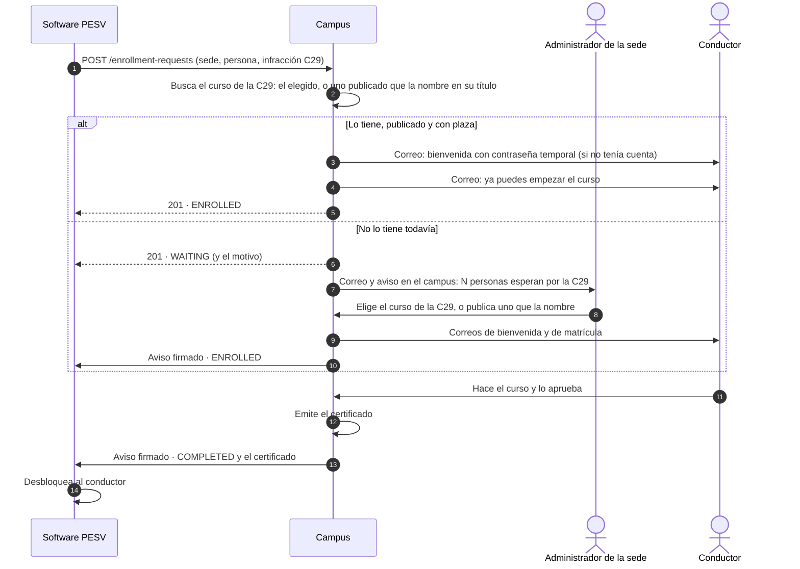

# Integración con otros sistemas

El campus recibe matrículas de otros sistemas por una API. El primero es el **software PESV**:
cuando bloquea a un conductor por una infracción, pide que haga el curso de esa infracción, y el
campus le avisa cuando lo termina para que vuelva a habilitarlo.

El PESV no necesita saber nada de los cursos del campus: envía la sede, la persona y la infracción
tal como la tiene (su código, como `C29`, y si quiere su descripción), y el campus busca el curso
por su título. Si no lo encuentra, el administrador de la sede lo elige una sola vez; desde
entonces, todo es automático.

Esta guía es el contrato entre los dos equipos. La especificación formal, para generar un
cliente o probar la API con una herramienta, está en
[`integracion-openapi.yaml`](integracion-openapi.yaml) (OpenAPI 3.1).

## Cómo funciona



1. **El PESV pide la matrícula** con un identificador propio (el de la infracción concreta), la
   sede, el código del tipo de infracción y los datos de la persona.
2. **El campus registra la infracción** la primera vez que la recibe, en la sede, con la
   descripción que envíe el PESV. No hay que darla de alta antes.
3. **El campus busca su curso**: el que se le eligió o, si no tiene, un curso publicado de la sede
   cuyo título la nombre (ver [cómo se elige](#2-el-curso-de-cada-infracción)).
4. **Si lo encuentra**, publicado y con plaza, la persona queda matriculada al instante. Si no
   tiene cuenta, se le crea con una contraseña temporal que recibe por correo; si ya la tiene,
   entra con la suya.
5. **Si no, la solicitud espera.** Los administradores de la sede reciben un correo y un aviso en
   la campana —uno al día por infracción, con el recuento de personas— y eligen su curso en
   **Administración → Integraciones**, o publican uno que la nombre. En ese momento todos los que
   esperaban quedan matriculados y reciben su correo, y las siguientes solicitudes de esa
   infracción entran solas. Nadie tiene que volver a enviar nada.
6. **El campus avisa al PESV** de cada cambio —matriculada, terminada, dada de baja, rechazada—
   con una petición firmada a la dirección que el PESV le haya dado. Al aprobar el curso, el aviso
   dice `COMPLETED` e incluye el código del certificado y el enlace público para verificarlo. El
   PESV también puede consultar el estado cuando quiera.

## Antes de conectar

### 1. La clave de la sede

Cada sede del campus (Colombia, México) es independiente, y la clave pertenece a una de ellas. Si
el PESV opera en las dos, necesita una clave por sede: cada solicitud dice su sede y va con la
clave de esa sede. Una solicitud para otra sede que la de la clave se rechaza (`403`), para que
un descuido no matricule a nadie en el país equivocado.

En el campus, un administrador de la sede entra en **Administración → Integraciones →
Sistemas conectados**, escribe el nombre del sistema y pulsa **Conectar sistema**. La clave
(`lms_` y 43 caracteres más) se muestra **una sola vez**: se copia y se entrega al equipo del
PESV por un canal seguro (nunca por correo ni chat en claro).

| Acción en el panel    | Efecto                                                                                           |
| --------------------- | ------------------------------------------------------------------------------------------------ |
| **Avisos**            | La dirección a la que avisar al sistema, y un aviso de prueba (ver el punto 3)                   |
| **Nueva clave**       | Emite otra y la anterior deja de funcionar en ese momento. Para rotarla o si se perdió           |
| **Desconectar**       | Revoca la clave: el sistema recibe `401` hasta que se le emita otra, y no se le envían avisos    |
| **Volver a conectar** | Emite una clave nueva para un sistema desconectado                                               |
| **Eliminar**          | Borra un sistema desconectado y sus solicitudes, cuando ya no se va a usar. No se puede deshacer |

Las solicitudes pertenecen al sistema, no a la clave: tras renovarla, el PESV sigue
consultando las que envió con la anterior, y los avisos van firmados con la nueva.

### 2. El curso de cada infracción

El PESV envía el código de cada tipo de infracción **tal como lo tiene**, sin acordar nada antes.
El campus lo compara sin mayúsculas, tildes, espacios ni signos: `C29`, `c.29`, `C-29` y `C 29` son
la misma infracción.

La primera vez que llega una infracción, el campus le busca curso entre los **publicados** de la
sede, por su título:

1. **Por el código**: el título lleva el código de la infracción como palabra. A la `C29` la
   atienden «C29», «Curso C-29» o «C 29 Conducir rápido», pero no «C290». Sólo con códigos de
   letras y cifras, que no se confunden con una palabra o un número cualquiera del título, y sin
   contar los ceros a la izquierda (`C02` es `C2`).
2. **Por la descripción**: el título dice lo mismo que la descripción de la infracción
   («Conducir rápido») o una frase de al menos dos palabras de uno está entera en el otro
   («Conducir rápido» atiende «Por conducir rápido en zona escolar»).

El código manda sobre la descripción, y un título igual a la descripción sobre uno que sólo la
contiene. **En la duda no elige**: si encajan dos cursos por igual, la solicitud espera a que
elija un administrador.

El curso encontrado queda elegido para esa infracción —el panel lo marca **Curso elegido por su
título**— y un administrador puede cambiarlo cuando quiera en **Administración → Integraciones →
Infracciones y cursos**, donde ve cada infracción que ha llegado, su descripción, su curso y quién
espera por ella. Cambiar el curso de una infracción vale para las solicitudes que esperan y las
que lleguen después; las ya matriculadas siguen en el suyo. Un mismo curso puede atender varias
infracciones, y renombrarlo no rompe nada.

Cada sede tiene sus propias infracciones y sus propios cursos: la `C29` de Colombia y una `C29`
de México son infracciones distintas, cada una con el curso de su sede.

### 3. La dirección de avisos

Para que el campus le avise de cada cambio, el PESV publica una dirección **https** que reciba
peticiones `POST` (ver [Avisos](#avisos)) y se la da al administrador de la sede, que la escribe
en **Avisos** junto al sistema y pulsa **Enviar aviso de prueba** para comprobar que llega. El
panel muestra cuándo salió el último aviso y, si no llegó, por qué.

Tiene que ser una dirección con nombre de dominio —no una IP ni `localhost`— y contestar
directamente: el campus no sigue redirecciones. Sin dirección, el PESV tendrá que consultar el
estado por su cuenta; los avisos de lo que cambie mientras tanto esperan y salen en cuanto la
tenga.

## Referencia de la API

| Entorno    | URL base                                                    |
| ---------- | ----------------------------------------------------------- |
| Producción | `https://api-lms.investigaciongipia.com/api/integration/v1` |
| Desarrollo | `http://localhost:3200/api/integration/v1`                  |

Todas las peticiones:

- van por **HTTPS** (en producción no hay otra forma);
- llevan la clave en la cabecera **`X-Api-Key`** —nunca en la URL, donde quedaría en los
  registros—;
- envían y reciben JSON en UTF-8 (`Content-Type: application/json`).

Son llamadas de servidor a servidor: el navegador de nadie interviene, así que no hay CORS ni
cookies.

### Pedir una matrícula

`POST /enrollment-requests`

```json
{
  "externalId": "INF-2026-000123",
  "country": "CO",
  "infractionCode": "C29",
  "infractionDescription": "Conducir a velocidad superior a la máxima permitida",
  "firstName": "Laura",
  "lastName": "Gómez",
  "email": "laura.gomez@example.com"
}
```

| Campo                   | Reglas                                                                                                                                                                                                                              |
| ----------------------- | ----------------------------------------------------------------------------------------------------------------------------------------------------------------------------------------------------------------------------------- |
| `externalId`            | Identificador de la solicitud en el PESV, como el número de la infracción. Hasta 100 caracteres: letras sin tilde, cifras, `.`, `_`, `:` y `-`. **Único por solicitud**, sin distinguir mayúsculas (`inf-1` e `INF-1` son el mismo) |
| `country`               | La sede de la persona: `CO` (Colombia) o `MX` (México). También vale su nombre, con o sin tildes y en cualquier capitalización (`Colombia`, `méxico`). Tiene que ser la sede de la clave                                            |
| `infractionCode`        | Código del tipo de infracción, como lo tenga el PESV. Se guarda sin espacios ni signos y en mayúsculas (`c.29` → `C29`): hasta 50 letras y cifras, al menos una                                                                     |
| `infractionDescription` | Opcional. Qué es la infracción, hasta 255 caracteres: con ella también se busca su curso, y es lo que lee el administrador si tiene que elegirlo                                                                                    |
| `firstName`             | Nombre, hasta 100 caracteres. Si llega todo en mayúsculas o todo en minúsculas, se guarda con iniciales mayúsculas: `LAURA MARÍA` → `Laura María`                                                                                   |
| `lastName`              | Apellidos, igual que el nombre: `GÓMEZ DE LA CRUZ` → `Gómez de la Cruz`                                                                                                                                                             |
| `email`                 | Correo de la persona: con él entra al campus. Hasta 191 caracteres, sin espacios ni tildes (un dominio internacional va en su forma `xn--`)                                                                                         |

Todos son obligatorios salvo la descripción, y a todos se les quitan los espacios sobrantes. Un
campo que no esté en la lista se rechaza (`400`): así un error de nombre (`infraccion` en lugar de
`infractionCode`) no pasa inadvertido.

Respuestas:

- **`201 Created`**: solicitud nueva. El cuerpo es la [solicitud](#la-solicitud), ya atendida:
  `ENROLLED` si la infracción tenía un curso disponible o `WAITING` si no.
- **`200 OK`**: ya existía una con ese `externalId`, la misma persona y la misma infracción (un
  reintento). Devuelve esa, en su estado actual; no se crea otra ni se repiten los correos.

### Consultar una solicitud

`GET /enrollment-requests/{externalId}`

Devuelve `200` con la [solicitud](#la-solicitud), o `404` si este sistema no envió ninguna con
ese identificador.

### Retirar una solicitud

`DELETE /enrollment-requests/{externalId}`

Para una solicitud que ya no hace falta, como la de una infracción anulada. Sólo se retira
mientras espera (`WAITING`): queda `REJECTED` y la persona no llega a matricularse. Responde `200`
con la [solicitud](#la-solicitud), también si ya no esperaba porque se había retirado o
rechazado antes. Si ya se atendió (`ENROLLED` o `COMPLETED`), responde `409`: la matrícula sigue
en pie, y quitarla lo decide un administrador del campus.

Un identificador retirado no se reutiliza: si más adelante hace falta el curso, se pide con otro.

### La solicitud

Lo que devuelven las tres rutas y lo que llevan los avisos:

```json
{
  "id": "335fbb2d-16c5-4155-a6ad-e0fb4f3d2589",
  "externalId": "INF-2026-000123",
  "status": "COMPLETED",
  "waitingReason": null,
  "detail": "La persona completó el curso. Certificado CERT-9F2A61C04B-MH8K2X1Q.",
  "country": "CO",
  "infraction": { "code": "C29", "description": "Conducir a velocidad superior a la máxima permitida" },
  "person": { "firstName": "Laura", "lastName": "Gómez", "email": "laura.gomez@example.com" },
  "course": {
    "title": "C29 Exceso de velocidad",
    "url": "https://lms.investigaciongipia.com/courses/0d2e2599-30c4-4d7f-868c-6f33ead6f7e8"
  },
  "requestedAt": "2026-10-27T13:02:11.087Z",
  "enrolledAt": "2026-10-27T13:02:11.512Z",
  "certificate": {
    "code": "CERT-9F2A61C04B-MH8K2X1Q",
    "verificationUrl": "https://lms.investigaciongipia.com/verify?code=CERT-9F2A61C04B-MH8K2X1Q",
    "issuedAt": "2026-11-02T21:15:47.000Z",
    "validUntil": "2027-11-02T21:15:47.000Z"
  }
}
```

| Campo           | Qué es                                                                                                         |
| --------------- | -------------------------------------------------------------------------------------------------------------- |
| `id`            | Identificador de la solicitud en el campus                                                                     |
| `externalId`    | El del PESV                                                                                                    |
| `status`        | En qué punto está (tabla siguiente)                                                                            |
| `waitingReason` | Por qué espera, sólo con `WAITING`; si no, `null`                                                              |
| `detail`        | Lo mismo en una frase en español, para mostrarla a una persona. No es para interpretarla                       |
| `country`       | La sede, en código ISO: `CO` o `MX`                                                                            |
| `infraction`    | La infracción por la que se pidió: su código normalizado y la última descripción recibida (`null` si ninguna)  |
| `person`        | Los datos recibidos, normalizados: el nombre como se guardó y el correo en minúsculas                          |
| `course`        | El curso en el que quedó y su enlace; `null` mientras espera                                                   |
| `requestedAt`   | Cuándo llegó la solicitud                                                                                      |
| `enrolledAt`    | Desde cuándo cuenta la matrícula; `null` mientras espera, o si ya había completado el curso antes de atenderse |
| `certificate`   | Con `COMPLETED`: código, enlace de verificación, emisión y vencimiento (`null` si no vence)                    |

Las fechas van en ISO 8601, en UTC.

### Estados

| `status`    | Significado                                                                                                                          | ¿Cambia?                               |
| ----------- | ------------------------------------------------------------------------------------------------------------------------------------ | -------------------------------------- |
| `WAITING`   | Espera a que la infracción tenga un curso disponible. `waitingReason` dice qué falta                                                 | Sí, en cuanto el curso esté disponible |
| `ENROLLED`  | Matriculada; la persona puede hacer el curso                                                                                         | Sí, al aprobar o si se da de baja      |
| `COMPLETED` | Aprobó el curso y tiene certificado                                                                                                  | No                                     |
| `CANCELLED` | Ya no está matriculada: un administrador le dio de baja, o se eliminó el curso o la cuenta. `detail` dice cuál                       | Sólo si un administrador la reactiva   |
| `REJECTED`  | No se atenderá: el correo es de un examinador o de otra sede, un administrador de la sede la descartó, o el propio sistema la retiró | No                                     |

| `waitingReason`        | Qué falta                                                                      |
| ---------------------- | ------------------------------------------------------------------------------ |
| `COURSE_NOT_ASSIGNED`  | La infracción todavía no tiene curso: ninguno publicado la nombra en su título |
| `COURSE_NOT_PUBLISHED` | Su curso existe, pero no está publicado                                        |
| `COURSE_FULL`          | Su curso no tiene plazas libres                                                |
| `null`                 | Ya se puede atender: se atiende antes de una hora                              |

Detalles que conviene saber:

- **Cada infracción es un curso completo.** Si la persona ya lo había aprobado antes, empieza de
  cero y obtiene un certificado nuevo. Si lo está haciendo cuando llega otra infracción con el
  mismo curso, sigue donde iba (aunque el curso esté lleno: no ocupa otra plaza), y al aprobar
  se completan las dos solicitudes.
- **Cuenta terminarlo después de la solicitud.** Si mientras esperaba la matricularon a mano y
  lo aprobó, la solicitud queda `COMPLETED` con ese certificado, sin repetirlo.
- **Una solicitud `COMPLETED` no vuelve atrás**, aunque el certificado venza después. Si el PESV
  necesita que la persona lo repita, envía una solicitud nueva.
- El campus vuelve a intentar las que esperan al elegir el curso de su infracción, al publicar un
  curso o cambiarle el cupo o el título, y cada hora (por ejemplo, cuando se libera una plaza).

### Errores

Todos los errores tienen la misma forma:

```json
{
  "statusCode": 409,
  "error": "Conflict",
  "message": "El identificador INF-2026-000123 ya se usó para otra solicitud (laura.gomez@example.com, infracción C29). Cada solicitud necesita el suyo.",
  "timestamp": "2026-10-27T13:02:11.476Z",
  "requestId": "18134d3c-58d6-4b26-8640-9087cf0a9f8d"
}
```

`message` está en español y es para personas: el programa decide por `statusCode`. Al reportar
un problema al equipo del campus, incluye el `requestId`.

| Código | Cuándo                                                                                                                                                                                                                                   | Qué hacer                                                   |
| ------ | ---------------------------------------------------------------------------------------------------------------------------------------------------------------------------------------------------------------------------------------- | ----------------------------------------------------------- |
| `400`  | Datos no válidos: falta un campo, sobra uno o un formato no se cumple. `message` enumera todos los problemas                                                                                                                             | Corregir los datos. No reintentar                           |
| `401`  | Falta la clave, no es válida o fue revocada                                                                                                                                                                                              | Revisar la configuración y avisar. No reintentar            |
| `403`  | La sede de la solicitud (`country`) no es la de la clave                                                                                                                                                                                 | Enviarla con la clave de esa sede                           |
| `404`  | (Consulta o retirada) Este sistema no envió ninguna solicitud con ese `externalId`                                                                                                                                                       | Revisar el identificador                                    |
| `409`  | El `externalId` ya se usó con otra persona u otra infracción; el correo es de una cuenta que no puede matricularse en la sede (un examinador, un administrador, alguien de la otra sede), o se intenta retirar una solicitud ya atendida | Revisar los datos. No reintentar                            |
| `429`  | Demasiadas peticiones seguidas                                                                                                                                                                                                           | Esperar los segundos de la cabecera `Retry-After` y repetir |
| `5xx`  | Fallo del campus (`503` si la base de datos no está disponible) o del servidor                                                                                                                                                           | Reintentar más tarde (ver abajo)                            |

### Límites

Desde una misma IP se admiten **120 peticiones por minuto en cada ruta** (pedir, consultar y
retirar se cuentan por separado) y, al pedir, **5 por minuto para un mismo correo**. Es holgado
para este uso; si un envío masivo lo alcanzara, la respuesta `429` dice en `Retry-After` cuántos
segundos esperar.

## Avisos

Cuando cambia el `status` de una solicitud —queda matriculada, la aprueba, la dan de baja o se
rechaza—, el campus envía un `POST` a la dirección de avisos del sistema que la pidió, en el
minuto siguiente al cambio:

```http
POST /avisos-campus HTTP/1.1
Host: pesv.example.com
Content-Type: application/json
X-Lms-Signature: t=1730131200,v1=5257a869e7ecebeda32affa62cdca3fa51cad7e77a0e56ff536d0ce8e108d8bd

{"event":"enrollment-request.updated","sentAt":"2026-10-28T16:00:00.000Z","request":{ … }}
```

| Campo     | Qué es                                                                                          |
| --------- | ----------------------------------------------------------------------------------------------- |
| `event`   | `enrollment-request.updated`, o `ping` en el aviso de prueba del panel (que no lleva `request`) |
| `sentAt`  | Cuándo salió el aviso                                                                           |
| `request` | La [solicitud](#la-solicitud) tal como la devolvería su consulta en ese momento                 |

**Qué tiene que contestar el PESV**: cualquier `2xx` en menos de 10 segundos, sin redirigir. Lo
mejor es guardar el aviso, contestar enseguida y procesarlo después. Si no contesta así, el campus
lo reintenta cada 15 minutos hasta que llegue; el panel del campus muestra por qué falló. Los
avisos de un sistema desconectado esperan a que se le emita una clave nueva.

**El aviso lleva el estado de ese momento**, no el cambio: si la persona se matricula y termina el
curso antes de que llegue el primer aviso, el siguiente ya dice `COMPLETED`. Puede llegar más de
uno con el mismo estado, así que procesarlo dos veces no debe hacer nada distinto. En la duda, la
consulta `GET` siempre dice el estado real. El estado inicial no se avisa: ya lo dice la respuesta
al `POST`.

**La firma** prueba que el aviso lo envía el campus y que nadie lo ha alterado. La cabecera
`X-Lms-Signature` lleva `t`, el instante del envío en segundos, y `v1`, el HMAC-SHA256 en
hexadecimal de `t`, un punto y el cuerpo tal como llegó. El secreto del HMAC es el **resumen
SHA-256 de la clave de la sede, en hexadecimal y minúsculas**: el PESV lo calcula de la clave que
ya tiene, sin otro secreto que guardar, y al renovar la clave cambia con ella. El PESV rechaza
el aviso si la firma no coincide o si `t` tiene más de 5 minutos.

```js
// Node.js: `rawBody` es el cuerpo tal como llegó, sin volver a serializarlo.
import { createHash, createHmac, timingSafeEqual } from 'node:crypto';

const secret = createHash('sha256').update(process.env.LMS_API_KEY).digest('hex');

function isFromCampus(signatureHeader, rawBody) {
  const { t, v1 = '' } = Object.fromEntries(signatureHeader.split(',').map((part) => part.split('=')));
  if (Math.abs(Date.now() / 1000 - Number(t)) > 300) return false;
  const expected = createHmac('sha256', secret).update(`${t}.${rawBody}`).digest('hex');
  return v1.length === expected.length && timingSafeEqual(Buffer.from(v1), Buffer.from(expected));
}
```

```php
// PHP
$secret = hash('sha256', getenv('LMS_API_KEY'));
$rawBody = file_get_contents('php://input');
parse_str(str_replace(',', '&', $_SERVER['HTTP_X_LMS_SIGNATURE'] ?? ''), $signature);
$expected = hash_hmac('sha256', ($signature['t'] ?? '') . '.' . $rawBody, $secret);
$isFromCampus = abs(time() - (int) ($signature['t'] ?? 0)) <= 300
    && hash_equals($expected, $signature['v1'] ?? '');
```

## Lo que tiene que construir el PESV

### 1. Configuración

La URL base y la clave de cada sede, en variables de entorno o en el gestor de secretos del
servidor. **Nunca en el código ni en el repositorio**, ni en los registros.

No hace falta relacionar infracciones con cursos ni conocer los cursos del campus: el campus los
busca por su título y, si no los encuentra, los elige cada sede en su panel.

### 2. Enviar la solicitud sin perderla

Una caída de red o del campus no debe dejar a un conductor sin su curso. El patrón recomendado
es una **bandeja de salida** (_transactional outbox_):

1. Al bloquear al conductor, en la **misma transacción**, se guarda en el PESV la solicitud
   pendiente con su `externalId` (el de la infracción: estable, no uno generado en cada intento).
2. Un proceso aparte envía las pendientes y anota el resultado.
3. Ante un fallo de red, un `5xx` o un `429`, reintenta **con el mismo `externalId`**: la API es
   idempotente, así que repetir nunca duplica la matrícula ni los correos. Espera cada vez el
   doble (1, 2, 4, 8… minutos, con algo de azar y un máximo de una hora) o lo que diga
   `Retry-After`.
4. Ante un `400`, `401`, `403` o `409`, no reintenta: marca la solicitud para que la revise una
   persona.

Tanto `201` como `200` significan que el campus la tiene.

### 3. Recibir los avisos

Una ruta `POST` en https, cuya dirección se da al administrador de cada sede, que comprueba la
firma, guarda el aviso, contesta `200` y lo procesa por su `externalId`:

| `status`    | Qué hace el PESV                                                           |
| ----------- | -------------------------------------------------------------------------- |
| `ENROLLED`  | Nada: la persona está en ello. Puede guardar el enlace del curso           |
| `COMPLETED` | Guarda el código y el enlace del certificado y **desbloquea al conductor** |
| `CANCELLED` | Avisa a una persona del PESV: la matrícula se anuló en el campus           |
| `REJECTED`  | Avisa a una persona del PESV con `detail`                                  |

Con los avisos no hace falta consultar. Aun así, conviene una **consulta de respaldo** —por
ejemplo una vez al día— de las solicitudes que siguen en `WAITING` o `ENROLLED`: cubre un aviso
que se procesó mal y el tiempo en que la dirección de avisos no esté configurada. Una consulta
que responde `404` significa que la solicitud no llegó: se reenvía (el `POST` es idempotente).

### 4. Si se anula la infracción

Si se anula antes de que la persona quede matriculada, el PESV retira la solicitud con `DELETE`.
Si responde `409`, ya está matriculada o terminó el curso: la matrícula sigue en pie, y quitarla
lo decide un administrador del campus.

### 5. Verificar el certificado (opcional)

`verificationUrl` es la página pública del campus que confirma que el certificado es auténtico,
para enlazarla desde el PESV. Para comprobarlo sin pasar por la página:
`GET https://api-lms.investigaciongipia.com/api/certificates/verify/{code}` (pública, sin
clave), que responde `valid: true` con el titular, el curso y el vencimiento.

### Ejemplos

```bash
# Pedir la matrícula
curl -sS https://api-lms.investigaciongipia.com/api/integration/v1/enrollment-requests \
  -H "X-Api-Key: $LMS_API_KEY" \
  -H 'Content-Type: application/json' \
  -d '{"externalId":"INF-2026-000123","country":"CO","infractionCode":"C29","infractionDescription":"Conducir a velocidad superior a la máxima permitida","firstName":"Laura","lastName":"Gómez","email":"laura.gomez@example.com"}'

# Consultar en qué punto está
curl -sS https://api-lms.investigaciongipia.com/api/integration/v1/enrollment-requests/INF-2026-000123 \
  -H "X-Api-Key: $LMS_API_KEY"

# Retirarla si se anula la infracción
curl -sS -X DELETE https://api-lms.investigaciongipia.com/api/integration/v1/enrollment-requests/INF-2026-000123 \
  -H "X-Api-Key: $LMS_API_KEY"
```

El proceso completo, en pseudocódigo:

```text
al bloquear(conductor, infracción):
    en una transacción:
        bloquear conductor
        guardar pendiente { externalId: infracción.id, country: conductor.sede, infractionCode: infracción.tipo, conductor, estado: POR_ENVIAR }

cada minuto, para cada pendiente POR_ENVIAR cuyo próximo intento ya llegó:
    respuesta = POST /enrollment-requests con sus datos y la clave de su sede
    si 200 o 201:                estado = respuesta.status
    si 429:                      próximo intento = ahora + Retry-After
    si 5xx o fallo de red:       próximo intento = ahora + espera creciente
    si 400, 401, 403 o 409:      estado = REVISAR; avisar a una persona con respuesta.message

al recibir un aviso en POST /avisos-campus:
    si la firma no es válida:    responder 401
    guardar el aviso; responder 200
    procesar: estado = aviso.request.status
    si COMPLETED:                guardar aviso.request.certificate; desbloquear conductor
    si CANCELLED o REJECTED:     avisar a una persona con aviso.request.detail

una vez al día, para cada pendiente en WAITING o ENROLLED:
    respuesta = GET /enrollment-requests/{externalId}
    procesarla como un aviso; si 404: estado = POR_ENVIAR

al anular(infracción):
    si su pendiente sigue POR_ENVIAR: descartarla sin enviarla
    si no: DELETE /enrollment-requests/{externalId}; si 409, avisar a una persona
```

## Lo que hace el campus

Para los administradores de cada sede, en **Administración → Integraciones**:

- **Infracciones y cursos**: cada infracción que ha llegado, con su descripción y su curso —el
  elegido por su título lleva la marca **Curso elegido por su título**—, que se elige o se cambia
  de una lista. Arriba, las que tienen a alguien esperando: qué falta (elegir el curso,
  publicarlo, ampliar el cupo), quién espera y desde cuándo, y qué sistema lo pidió. Se actualiza
  solo. **Descartar** retira a alguien de la espera si no se va a atender; el PESV la verá
  `REJECTED`.
- **Sistemas conectados**: claves emitidas, cuándo se usaron por última vez, la dirección de
  avisos y cómo fue el último, renovarlas, revocarlas y eliminar los sistemas que ya no se usan.
- **Cómo se conecta un sistema**: un resumen de esta guía, con la URL de la sede.

Los correos que salen —el aviso a los administradores (_Matrícula en espera por infracción_), la
bienvenida con la contraseña temporal y el de matrícula— se editan en **Plantillas de correo**,
como todos.

### Seguridad

- La clave sólo sirve para pedir, consultar y retirar las solicitudes propias, y sólo en su
  sede: no da acceso a ningún otro dato del campus ni a solicitudes de otros sistemas o de la otra
  sede.
- El campus guarda sólo su huella (SHA-256), no la clave: ni una copia de la base permite
  usarla. Por eso no se puede volver a mostrar; si se pierde, se emite otra.
- Los avisos van sólo por https, a una dirección con nombre de dominio, firmados y sin seguir
  redirecciones; no incluyen nada que el PESV no tenga ya o no pueda consultar con su clave.
- La cuenta que se crea es siempre de alumno, y sólo en la sede de la clave. Un correo que ya
  pertenece a un examinador, a un administrador o a otra sede se rechaza: una solicitud nunca
  da acceso a una cuenta ajena.
- La persona acepta la política de tratamiento de datos de la sede la primera vez que entra,
  como cualquier otra.

## Versiones

Esta es la **versión 1** (`/integration/v1`). Mientras exista, sus campos, estados y avisos no se
renombran ni se retiran. Sí pueden aparecer campos nuevos en las respuestas y en los avisos: el
cliente debe ignorar los que no conozca. Un cambio incompatible iría en `/integration/v2`, y las
dos versiones convivirían mientras el PESV se adapta.
