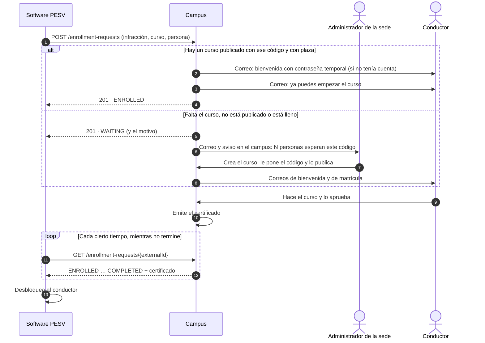

# Integración con otros sistemas

El campus recibe matrículas de otros sistemas por una API. El primero es el **software PESV**:
cuando bloquea a un conductor por una infracción, pide que haga el curso que lo vuelve a
habilitar, y consulta después si lo terminó.

Esta guía es el contrato entre los dos equipos. La especificación formal, para generar un
cliente o probar la API con una herramienta, está en
[`integracion-openapi.yaml`](integracion-openapi.yaml) (OpenAPI 3.1).

## Cómo funciona



1. **El PESV pide la matrícula** con un identificador propio (el de la infracción), el código
   del curso y los datos de la persona.
2. **El campus la atiende al instante** si hay un curso publicado, con plaza, que lleve ese
   código. Si la persona no tiene cuenta, se le crea con una contraseña temporal que recibe por
   correo; si ya la tiene, entra con la suya.
3. **Si el curso no está disponible, la solicitud espera.** Los administradores de la sede
   reciben un correo y un aviso en la campana —uno al día por código, con el recuento de
   personas—. En cuanto el curso queda publicado con ese código, todos los que esperaban quedan
   matriculados y reciben su correo. Nadie tiene que volver a enviar nada.
4. **El PESV consulta el estado** cuando quiera. Al aprobar el curso, la respuesta pasa a
   `COMPLETED` e incluye el código del certificado y el enlace público para verificarlo.

## Antes de conectar

### 1. La clave de la sede

Cada sede del campus (Colombia, México) es independiente, y la clave decide en cuál entra cada
solicitud. Si el PESV opera en las dos, necesita una clave por sede y usa la de la sede del
conductor.

En el campus, un administrador de la sede entra en **Administración → Integraciones →
Sistemas conectados**, escribe el nombre del sistema y pulsa **Conectar sistema**. La clave
(`lms_` y 43 caracteres más) se muestra **una sola vez**: se copia y se entrega al equipo del
PESV por un canal seguro (nunca por correo ni chat en claro).

| Acción en el panel    | Efecto                                                                                 |
| --------------------- | -------------------------------------------------------------------------------------- |
| **Nueva clave**       | Emite otra y la anterior deja de funcionar en ese momento. Para rotarla o si se perdió |
| **Desconectar**       | Revoca la clave: el sistema recibe `401` hasta que se le emita otra                    |
| **Volver a conectar** | Emite una clave nueva para un sistema desconectado                                     |

Las solicitudes pertenecen al sistema, no a la clave: tras renovarla, el PESV sigue
consultando las que envió con la anterior.

### 2. Los códigos de curso

El PESV no conoce los cursos del campus: pide por **código**, uno por tipo de formación, que
los dos equipos acuerdan antes (aunque el curso aún no exista). Por ejemplo:

| Infracción en el PESV       | Código del curso     |
| --------------------------- | -------------------- |
| Exceso de velocidad         | `MANEJO-DEFENSIVO`   |
| Uso del celular al conducir | `ATENCION-VIA`       |
| Sin elementos de protección | `SEGURIDAD-VIAL-EPP` |

En el campus, el administrador abre el curso en **Gestión de cursos → Configuración general →
Código de integración** y lo escribe. Sólo los administradores ven y cambian ese campo, y un
código no puede repetirse dentro de la sede.

Un código lleva letras sin tilde y cifras, en tramos separados por `-`, `_` o `.`, hasta 50
caracteres. Se compara en mayúsculas: `manejo-defensivo` y `MANEJO-DEFENSIVO` son el mismo.

## Referencia de la API

| Entorno    | URL base                                                    |
| ---------- | ----------------------------------------------------------- |
| Producción | `https://api-lms.investigaciongipia.com/api/integration/v1` |
| Desarrollo | `http://localhost:3200/api/integration/v1`                  |

Todas las peticiones:

- van por **HTTPS** (en producción no hay otra forma);
- llevan la clave en la cabecera **`X-Api-Key`** —nunca en la URL, donde quedaría en los
  registros—;
- envían y reciben JSON en UTF-8 (`Content-Type: application/json`).

Son llamadas de servidor a servidor: el navegador de nadie interviene, así que no hay CORS ni
cookies.

### Pedir una matrícula

`POST /enrollment-requests`

```json
{
  "externalId": "INF-2026-000123",
  "courseCode": "MANEJO-DEFENSIVO",
  "firstName": "Laura",
  "lastName": "Gómez",
  "email": "laura.gomez@example.com"
}
```

| Campo        | Reglas                                                                                                                                                                                                                              |
| ------------ | ----------------------------------------------------------------------------------------------------------------------------------------------------------------------------------------------------------------------------------- |
| `externalId` | Identificador de la solicitud en el PESV, como el número de la infracción. Hasta 100 caracteres: letras sin tilde, cifras, `.`, `_`, `:` y `-`. **Único por solicitud**, sin distinguir mayúsculas (`inf-1` e `INF-1` son el mismo) |
| `courseCode` | Código acordado del curso (ver arriba)                                                                                                                                                                                              |
| `firstName`  | Nombre, hasta 100 caracteres                                                                                                                                                                                                        |
| `lastName`   | Apellidos, hasta 100 caracteres                                                                                                                                                                                                     |
| `email`      | Correo de la persona: con él entra al campus. Hasta 191 caracteres, sin espacios ni tildes (un dominio internacional va en su forma `xn--`)                                                                                         |

Los cinco son obligatorios. Un campo que no esté en la lista se rechaza (`400`): así un error
de nombre (`curso` en lugar de `courseCode`) no pasa inadvertido. La sede no se envía: es la de
la clave.

Respuestas:

- **`201 Created`**: solicitud nueva. El cuerpo es la [solicitud](#la-solicitud), ya atendida:
  `ENROLLED` si el curso estaba disponible o `WAITING` si no.
- **`200 OK`**: ya existía una con ese `externalId`, la misma persona y el mismo curso (un
  reintento). Devuelve esa, en su estado actual; no se crea otra ni se repiten los correos.

### Consultar una solicitud

`GET /enrollment-requests/{externalId}`

Devuelve `200` con la [solicitud](#la-solicitud), o `404` si este sistema no envió ninguna con
ese identificador.

### Retirar una solicitud

`DELETE /enrollment-requests/{externalId}`

Para una solicitud que ya no hace falta, como la de una infracción anulada. Sólo se retira
mientras espera (`WAITING`): queda `REJECTED` y la persona no llega a matricularse. Responde `200`
con la [solicitud](#la-solicitud), también si ya no esperaba porque se había retirado o
rechazado antes. Si ya se atendió (`ENROLLED` o `COMPLETED`), responde `409`: la matrícula sigue
en pie, y quitarla lo decide un administrador del campus.

Un identificador retirado no se reutiliza: si más adelante hace falta el curso, se pide con otro.

### La solicitud

Lo que devuelven las dos rutas:

```json
{
  "id": "335fbb2d-16c5-4155-a6ad-e0fb4f3d2589",
  "externalId": "INF-2026-000123",
  "status": "COMPLETED",
  "waitingReason": null,
  "detail": "La persona completó el curso. Certificado CERT-9F2A61C04B-MH8K2X1Q.",
  "courseCode": "MANEJO-DEFENSIVO",
  "person": { "firstName": "Laura", "lastName": "Gómez", "email": "laura.gomez@example.com" },
  "course": {
    "title": "Manejo defensivo",
    "url": "https://lms.investigaciongipia.com/courses/0d2e2599-30c4-4d7f-868c-6f33ead6f7e8"
  },
  "requestedAt": "2026-10-27T13:02:11.087Z",
  "enrolledAt": "2026-10-27T15:40:03.512Z",
  "certificate": {
    "code": "CERT-9F2A61C04B-MH8K2X1Q",
    "verificationUrl": "https://lms.investigaciongipia.com/verify?code=CERT-9F2A61C04B-MH8K2X1Q",
    "issuedAt": "2026-11-02T21:15:47.000Z",
    "validUntil": "2027-11-02T21:15:47.000Z"
  }
}
```

| Campo           | Qué es                                                                                                         |
| --------------- | -------------------------------------------------------------------------------------------------------------- |
| `id`            | Identificador de la solicitud en el campus                                                                     |
| `externalId`    | El del PESV                                                                                                    |
| `status`        | En qué punto está (tabla siguiente)                                                                            |
| `waitingReason` | Por qué espera, sólo con `WAITING`; si no, `null`                                                              |
| `detail`        | Lo mismo en una frase en español, para mostrarla a una persona. No es para interpretarla                       |
| `courseCode`    | El código pedido, en mayúsculas                                                                                |
| `person`        | Los datos recibidos, con el correo en minúsculas                                                               |
| `course`        | El curso en el que quedó y su enlace; `null` mientras espera                                                   |
| `requestedAt`   | Cuándo llegó la solicitud                                                                                      |
| `enrolledAt`    | Desde cuándo cuenta la matrícula; `null` mientras espera, o si ya había completado el curso antes de atenderse |
| `certificate`   | Con `COMPLETED`: código, enlace de verificación, emisión y vencimiento (`null` si no vence)                    |

Las fechas van en ISO 8601, en UTC.

### Estados

| `status`    | Significado                                                                                                                                                  | ¿Cambia?                               |
| ----------- | ------------------------------------------------------------------------------------------------------------------------------------------------------------ | -------------------------------------- |
| `WAITING`   | Espera a que el curso esté disponible. `waitingReason` dice qué falta                                                                                        | Sí, en cuanto el curso esté disponible |
| `ENROLLED`  | Matriculada; la persona puede hacer el curso                                                                                                                 | Sí, al aprobar o si se da de baja      |
| `COMPLETED` | Aprobó el curso y tiene certificado                                                                                                                          | No                                     |
| `CANCELLED` | Ya no está matriculada: un administrador le dio de baja, o se eliminó el curso o la cuenta. `detail` dice cuál                                               | Sólo si un administrador la reactiva   |
| `REJECTED`  | No se atenderá: el correo es de un examinador o de otra sede, un administrador la descartó porque el curso no se va a ofrecer, o el propio sistema la retiró | No                                     |

| `waitingReason`        | Qué falta                                         |
| ---------------------- | ------------------------------------------------- |
| `COURSE_NOT_FOUND`     | Ningún curso de la sede lleva ese código          |
| `COURSE_NOT_PUBLISHED` | El curso existe, pero no está publicado           |
| `COURSE_FULL`          | El curso no tiene plazas libres                   |
| `null`                 | Ya se puede atender: se atiende antes de una hora |

Detalles que conviene saber:

- **Cada infracción es un curso completo.** Si la persona ya lo había aprobado antes, empieza de
  cero y obtiene un certificado nuevo. Si lo está haciendo cuando llega otra infracción del
  mismo curso, sigue donde iba (aunque el curso esté lleno: no ocupa otra plaza), y al aprobar
  se completan las dos solicitudes.
- **Cuenta terminarlo después de la solicitud.** Si mientras esperaba la matricularon a mano y
  lo aprobó, la solicitud queda `COMPLETED` con ese certificado, sin repetirlo.
- **Una solicitud `COMPLETED` no vuelve atrás**, aunque el certificado venza después. Si el PESV
  necesita que la persona lo repita, envía una solicitud nueva.
- El campus vuelve a intentar las que esperan al publicar un curso, al ponerle el código o
  ampliar su cupo, y cada hora (por ejemplo, cuando se libera una plaza).

### Errores

Todos los errores tienen la misma forma:

```json
{
  "statusCode": 409,
  "error": "Conflict",
  "message": "El identificador INF-2026-000123 ya se usó para otra solicitud (laura.gomez@example.com, MANEJO-DEFENSIVO). Cada solicitud necesita el suyo.",
  "timestamp": "2026-10-27T13:02:11.476Z",
  "requestId": "18134d3c-58d6-4b26-8640-9087cf0a9f8d"
}
```

`message` está en español y es para personas: el programa decide por `statusCode`. Al reportar
un problema al equipo del campus, incluye el `requestId`.

| Código | Cuándo                                                                                                                                                                                                                              | Qué hacer                                                   |
| ------ | ----------------------------------------------------------------------------------------------------------------------------------------------------------------------------------------------------------------------------------- | ----------------------------------------------------------- |
| `400`  | Datos no válidos: falta un campo, sobra uno o un formato no se cumple. `message` enumera todos los problemas                                                                                                                        | Corregir los datos. No reintentar                           |
| `401`  | Falta la clave, no es válida o fue revocada                                                                                                                                                                                         | Revisar la configuración y avisar. No reintentar            |
| `404`  | (Consulta o retirada) Este sistema no envió ninguna solicitud con ese `externalId`                                                                                                                                                  | Revisar el identificador                                    |
| `409`  | El `externalId` ya se usó con otra persona u otro curso; el correo es de una cuenta que no puede matricularse en la sede (un examinador, un administrador, alguien de la otra sede), o se intenta retirar una solicitud ya atendida | Revisar los datos. No reintentar                            |
| `429`  | Demasiadas peticiones seguidas                                                                                                                                                                                                      | Esperar los segundos de la cabecera `Retry-After` y repetir |
| `5xx`  | Fallo del campus (`503` si la base de datos no está disponible) o del servidor                                                                                                                                                      | Reintentar más tarde (ver abajo)                            |

### Límites

Desde una misma IP se admiten **120 peticiones por minuto en cada ruta** (pedir, consultar y
retirar se cuentan por separado) y, al pedir, **5 por minuto para un mismo correo**. Es holgado
para este uso; si un envío masivo lo alcanzara, la respuesta `429` dice en `Retry-After` cuántos
segundos esperar.

## Lo que tiene que construir el PESV

### 1. Configuración

- La URL base y la clave de cada sede, en variables de entorno o en el gestor de secretos del
  servidor. **Nunca en el código ni en el repositorio**, ni en los registros.
- Una tabla que relacione cada tipo de infracción con su código de curso.

### 2. Enviar la solicitud sin perderla

Una caída de red o del campus no debe dejar a un conductor sin su curso. El patrón recomendado
es una **bandeja de salida** (_transactional outbox_):

1. Al bloquear al conductor, en la **misma transacción**, se guarda en el PESV la solicitud
   pendiente con su `externalId` (el de la infracción: estable, no uno generado en cada intento).
2. Un proceso aparte envía las pendientes y anota el resultado.
3. Ante un fallo de red, un `5xx` o un `429`, reintenta **con el mismo `externalId`**: la API es
   idempotente, así que repetir nunca duplica la matrícula ni los correos. Espera cada vez el
   doble (1, 2, 4, 8… minutos, con algo de azar y un máximo de una hora) o lo que diga
   `Retry-After`.
4. Ante un `400`, `401` o `409`, no reintenta: marca la solicitud para que la revise una
   persona.

Tanto `201` como `200` significan que el campus la tiene.

### 3. Saber cuándo termina

El PESV consulta las solicitudes que no han terminado (`WAITING` o `ENROLLED`), por ejemplo
**una vez cada hora** —hacer el curso lleva horas o días, así que no hace falta más—, repartidas
en el tiempo si son muchas.

| Respuesta   | Qué hace el PESV                                                                              |
| ----------- | --------------------------------------------------------------------------------------------- |
| `WAITING`   | Nada: el campus avisa a sus administradores. Puede mostrar `detail` en su panel               |
| `ENROLLED`  | Nada: la persona está en ello                                                                 |
| `COMPLETED` | Guarda el código y el enlace del certificado y **desbloquea al conductor**. Deja de consultar |
| `CANCELLED` | Avisa a una persona del PESV: la matrícula se anuló en el campus                              |
| `REJECTED`  | Avisa a una persona del PESV con `detail`. Deja de consultar                                  |
| `404`       | La solicitud no llegó: la reenvía (el `POST` es idempotente)                                  |

Consultar en lugar de recibir avisos (_webhooks_) es deliberado: el PESV no necesita publicar
ninguna dirección en Internet ni verificar firmas, y si estuvo caído, al volver ve el estado
real. Si más adelante hiciera falta inmediatez, se añadiría en una versión nueva sin cambiar
esta.

### 4. Si se anula la infracción

Si se anula antes de que la persona quede matriculada, el PESV retira la solicitud con `DELETE`.
Si responde `409`, ya está matriculada o terminó el curso: la matrícula sigue en pie, y quitarla
lo decide un administrador del campus.

### 5. Verificar el certificado (opcional)

`verificationUrl` es la página pública del campus que confirma que el certificado es auténtico,
para enlazarla desde el PESV. Para comprobarlo sin pasar por la página:
`GET https://api-lms.investigaciongipia.com/api/certificates/verify/{code}` (pública, sin
clave), que responde `valid: true` con el titular, el curso y el vencimiento.

### Ejemplos

```bash
# Pedir la matrícula
curl -sS https://api-lms.investigaciongipia.com/api/integration/v1/enrollment-requests \
  -H "X-Api-Key: $LMS_API_KEY" \
  -H 'Content-Type: application/json' \
  -d '{"externalId":"INF-2026-000123","courseCode":"MANEJO-DEFENSIVO","firstName":"Laura","lastName":"Gómez","email":"laura.gomez@example.com"}'

# Consultar en qué punto está
curl -sS https://api-lms.investigaciongipia.com/api/integration/v1/enrollment-requests/INF-2026-000123 \
  -H "X-Api-Key: $LMS_API_KEY"

# Retirarla si se anula la infracción
curl -sS -X DELETE https://api-lms.investigaciongipia.com/api/integration/v1/enrollment-requests/INF-2026-000123 \
  -H "X-Api-Key: $LMS_API_KEY"
```

El proceso completo, en pseudocódigo:

```text
al bloquear(conductor, infracción):
    en una transacción:
        bloquear conductor
        guardar pendiente { externalId: infracción.id, curso: código(infracción.tipo), conductor, estado: POR_ENVIAR }

cada minuto, para cada pendiente POR_ENVIAR cuyo próximo intento ya llegó:
    respuesta = POST /enrollment-requests con sus datos
    si 200 o 201:            estado = respuesta.status
    si 429:                  próximo intento = ahora + Retry-After
    si 5xx o fallo de red:   próximo intento = ahora + espera creciente
    si 400, 401 o 409:       estado = REVISAR; avisar a una persona con respuesta.message

cada hora, para cada pendiente en WAITING o ENROLLED:
    respuesta = GET /enrollment-requests/{externalId}
    estado = respuesta.status
    si COMPLETED:            guardar respuesta.certificate; desbloquear conductor
    si CANCELLED o REJECTED: avisar a una persona con respuesta.detail
    si 404:                  estado = POR_ENVIAR

al anular(infracción):
    si su pendiente sigue POR_ENVIAR: descartarla sin enviarla
    si no: DELETE /enrollment-requests/{externalId}; si 409, avisar a una persona
```

## Lo que hace el campus

Para los administradores de cada sede, en **Administración → Integraciones**:

- **Matrículas en espera**, agrupadas por código: qué falta (crear el curso, publicarlo,
  ampliar el cupo), quién espera y desde cuándo, y qué sistema lo pidió. Se actualiza solo.
  **Descartar** retira a alguien de la espera si su curso no se va a ofrecer; el PESV la verá
  `REJECTED`.
- **Sistemas conectados**: claves emitidas, cuándo se usaron por última vez, renovarlas o
  revocarlas.
- **Cómo se conecta un sistema**: un resumen de esta guía, con la URL de la sede.

Los correos que salen —el aviso a los administradores (_Curso solicitado no disponible_), la
bienvenida con la contraseña temporal y el de matrícula— se editan en **Plantillas de correo**,
como todos.

### Seguridad

- La clave sólo sirve para pedir, consultar y retirar las solicitudes propias: no da acceso a
  ningún otro dato del campus ni a solicitudes de otros sistemas o de la otra sede.
- El campus guarda sólo su huella (SHA-256), no la clave: ni una copia de la base permite
  usarla. Por eso no se puede volver a mostrar; si se pierde, se emite otra.
- La cuenta que se crea es siempre de alumno, y sólo en la sede de la clave. Un correo que ya
  pertenece a un examinador, a un administrador o a otra sede se rechaza: una solicitud nunca
  da acceso a una cuenta ajena.
- La persona acepta la política de tratamiento de datos de la sede la primera vez que entra,
  como cualquier otra.

## Versiones

Esta es la **versión 1** (`/integration/v1`). Mientras exista, sus campos y estados no se
renombran ni se retiran. Sí pueden aparecer campos nuevos en las respuestas: el cliente debe
ignorar los que no conozca. Un cambio incompatible iría en `/integration/v2`, y las dos
versiones convivirían mientras el PESV se adapta.
